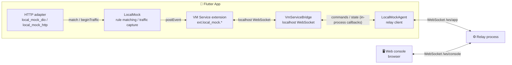

<div align="center">


# local_mock

**API mocking and traffic capture for Flutter apps**

No proxy, no certificates — inspect requests and rewrite responses live in your browser.

<p>
  
  
  
  
  <a href="https://github.com/Dabbit-Chan/local_mock/stargazers"></a>
</p>

<p>
  <a href="README.md">中文</a> ·
  <a href="README.en.md">English</a>
</p>

<p>
  <a href="#-features">Features</a> ·
  <a href="#-how-it-works">How it works</a> ·
  <a href="#-repository-layout">Repository layout</a>
</p>

</div>

---

local_mock is an API mocking and traffic capture tool for Flutter apps, built for development and testing. It shows the network requests your app makes in real time, and lets you edit rules in the browser to rewrite API responses. Use it to develop against fake data before an API is ready, to verify UI edge cases, or to reproduce a whole flow offline.

## ✨ Features

<table>
  <tr>
    <td width="50%" valign="top">
      <h4>🔌 No proxy required</h4>
      Intercepts inside the app's HTTP client — no system proxy to configure, no certificate to install.
    </td>
    <td width="50%" valign="top">
      <h4>📡 Live traffic capture</h4>
      Requests and responses stream into the browser console in real time. Filter them, and inspect full headers, request bodies and response bodies. Any request detail can be copied as a ready-to-run cURL command.
    </td>
  </tr>
  <tr>
    <td valign="top">
      <h4>🎭 Full replacement and field patches</h4>
      Return fake data for the whole response, or rewrite only a few fields of the real one.
    </td>
    <td valign="top">
      <h4>🎬 Record and replay</h4>
      Record an entire user flow as a group and replay it offline.
    </td>
  </tr>
  <tr>
    <td valign="top">
      <h4>🎯 Parameter-level matching</h4>
      Match rules on query or body parameters, so you can target a single order or a specific set of arguments.
    </td>
    <td valign="top">
      <h4>🛡️ Release safe</h4>
      Only active in Debug / Profile builds; every entry point is a no-op in Release.
    </td>
  </tr>
</table>

## 🚀 Running and building

When you run an app that integrates local_mock in Debug / Profile mode with `flutter run`, add `--no-dds` so that DDS does not take over the VM Service and prevent the console from discovering the device:

```bash
flutter run --debug --no-dds
flutter run --profile --no-dds
```

`flutter build` commands do not need `--no-dds`, for example:

```bash
flutter build apk --debug
flutter build apk --profile
```

## 🧭 How it works



- **Interception inside the app**: the adapters plug into the app's HTTP client (a Dio interceptor or `HttpOverrides`) and match rules before a request goes out, so no system proxy and no certificate is involved.
- **Reverse connection**: the app's `LocalMockAgent` dials the relay's `/ws/app` endpoint itself, streams capture events in real time, and receives console commands, which `VmServiceBridge` forwards to the local VM Service extension for execution.
- **Two WebSockets on the relay**: app ↔ relay uses `/ws/app`, console ↔ relay uses `/ws/console`. The `VmServiceBridge` connection to the local VM Service lives entirely inside the app; the relay never touches the VM Service and needs no inbound device port or credentials.
- **Rules live in the browser per device and take effect in app memory**: after a cold start the app has no rules, so click "Sync to device" on the device page. Once that succeeds, rule changes made during the current app session are pushed automatically. Matching happens in the app itself. A matching rule can return a whole fake payload or patch just some fields of the real response; requests that match nothing go to the network as usual.
- **Development builds only**: active in Debug / Profile builds only; every entry point is a no-op in Release. `LocalMock.enabled` is driven by `!kReleaseMode`, and in Release `connect` / `attach` / `install` return false without opening a relay connection. To verify against a near-production build, use a Profile build.

## 📦 Repository layout

| Module | Description |
| --- | --- |
| 🖥️ [`local_mock_client`](local_mock_client/README.md) | Web console and Dart relay |
| ⚙️ `local_mock_relay` | Go relay, deployable as a single binary |
| 🧩 [`local_mock_core`](local_mock_package/local_mock_core/README.md) | Rule model and matching, request records, recording; independent of any HTTP client |
| 🔗 [`local_mock_dio`](local_mock_package/local_mock_dio/README.md) | Dio 4.x / 5.x adapter |
| 🌐 [`local_mock_http`](local_mock_package/local_mock_http/README.md) | `HttpClient` / `package:http` adapter |
| 📡 [`local_mock_transport`](local_mock_package/local_mock_transport/README.md) | WebSocket protocol shared by the app, relay and console |
| 🤖 [`skills/local-mock-rules`](skills/local-mock-rules/SKILL.md) | A skill that helps AI assistants generate rule files |

> The relay ships in both Dart and Go. They speak the same protocol — pick either one.

> [!WARNING]
> The relay has no authentication. Anyone who can reach its address can see request contents and modify rules. Use it only locally or on a trusted internal network.
