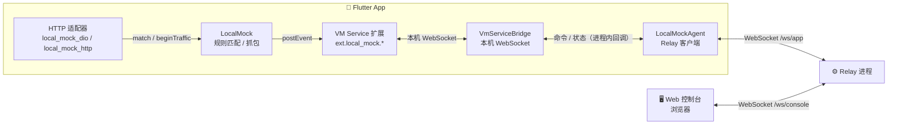

<div align="center">


# local_mock

**给 Flutter App 用的接口 Mock 与抓包工具**

不需要代理，不需要证书，在浏览器里实时查看请求、改写响应。

<p>
  
  
  
  
  <a href="https://github.com/Dabbit-Chan/local_mock/stargazers"></a>
</p>

<p>
  <a href="README.md">中文</a> ·
  <a href="README.en.md">English</a>
</p>

<p>
  <a href="#-特性">特性</a> ·
  <a href="#-技术原理">技术原理</a> ·
  <a href="#-仓库结构">仓库结构</a>
</p>

</div>

---

local_mock 是给 Flutter App 用的接口 Mock 与抓包工具，面向开发和测试阶段。它能实时查看 App 发出的网络请求，并在浏览器里编辑规则来改写接口响应。用它可以在接口未完成时用假数据开发、验证界面边界情况，也可以离线复现一整条操作流程。

## ✨ 特性

<table>
  <tr>
    <td width="50%" valign="top">
      <h4>🔌 零代理接入</h4>
      在 App 的 HTTP 客户端内部拦截，不需要配置系统代理，也不需要安装证书。
    </td>
    <td width="50%" valign="top">
      <h4>📡 实时抓包</h4>
      请求和响应实时上报到浏览器控制台，可以筛选，也可以查看完整的请求头、请求体和响应体。请求详情支持一键复制为可直接执行的 cURL 命令。
    </td>
  </tr>
  <tr>
    <td valign="top">
      <h4>🎭 整包替换与字段补丁</h4>
      既可以直接返回假数据，也可以只改写真实响应里的几个字段。
    </td>
    <td valign="top">
      <h4>🎬 录制与回放</h4>
      录下一整段操作流程，生成录制组后可以离线回放。
    </td>
  </tr>
  <tr>
    <td valign="top">
      <h4>🎯 参数级匹配</h4>
      按 query 或请求体参数命中规则，可以只改某一个订单、某一种传参。
    </td>
    <td valign="top">
      <h4>🛡️ Release 安全</h4>
      只在 Debug / Profile 构建中生效，Release 构建里所有入口都不做任何事。
    </td>
  </tr>
</table>

## 🚀 运行与打包

使用 `flutter run` 以 Debug / Profile 模式运行接入 local_mock 的 App 时，需要添加 `--no-dds`，避免 DDS 接管 VM Service 后导致控制台无法发现设备：

```bash
flutter run --debug --no-dds
flutter run --profile --no-dds
```

`flutter build` 打包命令不需要添加 `--no-dds`，例如：

```bash
flutter build apk --debug
flutter build apk --profile
```

## 🧭 技术原理



- **在 App 内部拦截**：适配器接入 App 的 HTTP 客户端（Dio 拦截器或 `HttpOverrides`），在请求发出前匹配规则，所以不需要系统代理，也不需要安装证书。
- **反向连接**：App 的 `LocalMockAgent` 主动连上 Relay 的 `/ws/app`，把抓包事件实时上报，并接收控制台命令；命令再由 `VmServiceBridge` 转给本机 VM Service 扩展执行。
- **Relay 侧的两条 WebSocket**：App ↔ Relay 是 `/ws/app`，控制台 ↔ Relay 是 `/ws/console`。`VmServiceBridge` 到本机 VM Service 的连接只在 App 内部，Relay 不直接访问 VM Service，也不需要设备入站端口或凭据。
- **规则按设备保存在浏览器中，在 App 内存中生效**：App 冷启动后规则为空，需在设备页点击“同步到设备”；成功后，本次 App 会话内修改规则会自动下发。规则下发后由 App 自己匹配。命中时可以直接返回整包数据，也可以只改写真实响应里的部分字段；没有命中的请求照常走真实网络。
- **只在开发构建中启用**：只在 Debug / Profile 构建中生效，Release 构建里所有入口都不做任何事。`LocalMock.enabled` 由 `!kReleaseMode` 决定，Release 下 `connect` / `attach` / `install` 都直接返回 false，也不会建立 Relay 连接。需要在接近生产的包中验证时，请使用 Profile 构建。

## 📦 仓库结构

| 模块 | 简介 |
| --- | --- |
| 🖥️ [`local_mock_client`](local_mock_client/README.md) | Web 控制台与 Dart Relay |
| ⚙️ `local_mock_relay` | Relay 层的独立实现 |
| 🧩 [`local_mock_core`](local_mock_package/local_mock_core/README.md) | 规则模型与匹配、请求记录、录制，不依赖具体 HTTP 客户端 |
| 🔗 [`local_mock_dio`](local_mock_package/local_mock_dio/README.md) | Dio 4.x / 5.x 适配器 |
| 🌐 [`local_mock_http`](local_mock_package/local_mock_http/README.md) | `HttpClient` / `package:http` 适配器 |
| 📡 [`local_mock_transport`](local_mock_package/local_mock_transport/README.md) | App、Relay、控制台之间的 WebSocket 通信协议 |
| 🤖 [`skills/local-mock-rules`](skills/local-mock-rules/SKILL.md) | 帮助 AI 助手生成规则文件的 Skill |

> Relay 有 Dart 和 Go 两种实现，协议一致，任选其一。

> [!WARNING]
> Relay 没有鉴权，能访问 Relay 地址的人都能看到请求内容并修改规则。请只在本地或内网中使用。
